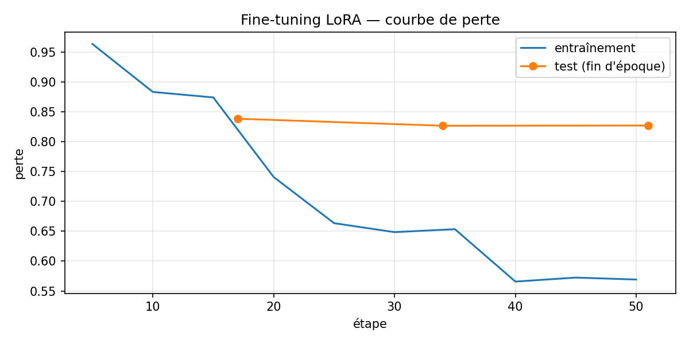

# AI Study Assistant

Assistant d'étude qui travaille **uniquement à partir des cours de l'étudiant** (PDF) : tuteur qui cite
ses pages, examens notés sur 20, flashcards, résumés et un agent qui choisit le bon outil. En local : LLM
**qwen2.5:7b** (Ollama), embeddings **multilingual-e5-small**, base vectorielle **Qdrant**. Déployable avec
**Docker** et le LLM **qwen/qwen3.8-27b** de **Groq**, en local ou sur **Hugging Face Spaces**.

> **Mini-projet** — Groupe : _à compléter (noms et prénoms des membres)_ · Classe : _à compléter_ ·
> Encadrant : _à compléter_ · Année universitaire : _à compléter_

## Sommaire

1. [Fonctionnalités](#fonctionnalités)
2. [Captures d'écran](#captures-décran)
3. [Architecture](#architecture)
4. [Installation sous Windows](#installation-sous-windows)
5. [Variables d'environnement](#variables-denvironnement)
6. [Lancement](#lancement)
7. [Tests](#tests)
8. [Benchmark et MLflow](#benchmark-et-mlflow)
9. [Fine-tuning LoRA](#fine-tuning-lora-phase-4-bis)
10. [Déploiement : Docker, Groq, Hugging Face Spaces](#déploiement--docker-groq-hugging-face-spaces)
11. [Documentation](#documentation)

## Fonctionnalités

Chaque phase du cahier des charges correspond à un dossier `backend/app/phaseN_…`.

| Phase | Fonctionnalité | Dossier |
|---|---|---|
| 1 | **Client LLM** compatible OpenAI (Ollama, Groq, OpenAI) : sorties structurées `json_schema`, erreurs traduites en messages clairs (503) | `phase1_llm/` |
| 2 | **Embeddings et indexation** : PDF découpé page par page (800 caractères, chevauchement 150), vecteurs e5 dans Qdrant, filtrés par étudiant | `phase2_embeddings/` |
| 3 | **Tuteur RAG** : réponses tirées du cours avec citations `[p.X]`, refus hors cours, mémoire de conversation, adaptation au niveau | `phase3_rag/` |
| 4 | **Générateur d'examens** : examen complet (QCM, Vrai/Faux, réponses courtes, réflexion) ou QCM rapide, toujours sur 20, avec corrigé, en PDF ; questions validées et auto-vérifiées | `phase4_exam/` |
| 4 bis | **Fine-tuning LoRA** de Qwen2.5-1.5B sur le style du tuteur (jeu de données local, entraînement Colab, évaluation base vs affiné) : citations `[p.X]` 3 % → 97 %, [modèle publié sur le Hub](https://huggingface.co/Alinajjaa/study-tutor-qwen2.5-1.5b-lora) | `phase4_finetuning/` |
| 5 | **Évaluation** : un run MLflow par génération, benchmark hors ligne, évaluation du choix d'outil de l'agent | `phase5_evaluation/` |
| 6 | **Agent Study Companion** (LangGraph) : choisit entre tuteur, résumé, quiz, flashcards et progression ; tâches de fond pour les générations longues | `phase6_agent/` |
| 7 | **Flashcards** : concepts clés du cours, une carte par concept, révision « Je savais / À revoir » | `phase7_flashcards/` |
| 8 | **Tuteur personnel** : comptes (JWT, bcrypt), cours privés, conversations, historiques, profil, points faibles, suggestion de niveau | `phase8_personal/` |
| 9 | **Résumés** : cours entier en map-reduce (chaque puce cite une page valide) ou explication d'un thème adaptée au niveau | `phase9_summaries/` |

Pages du frontend : **Assistant** (conversation avec l'agent, import de cours, quiz interactifs),
**Flashcards**, **Résumés**, **Mes examens**, **Profil**, connexion et inscription.

## Captures d'écran

> Emplacements prévus : déposer les images dans `docs/captures/` avec ces noms de fichiers.

| Écran | Fichier |
|---|---|
| Connexion / inscription | `docs/captures/01-connexion.png` |
| Assistant : question au tuteur avec sources `[p.X]` | `docs/captures/02-assistant-tuteur.png` |
| Assistant : quiz interactif corrigé | `docs/captures/03-assistant-quiz.png` |
| Génération d'un examen (options) | `docs/captures/04-examen-options.png` |
| Examen PDF avec corrigé | `docs/captures/05-examen-pdf.png` |
| Révision de flashcards | `docs/captures/06-flashcards.png` |
| Résumé du cours entier | `docs/captures/07-resume.png` |
| Profil : statistiques et points faibles | `docs/captures/08-profil.png` |
| MLflow : runs du benchmark | `docs/captures/09-mlflow-runs.png` |
| MLflow : trace de l'agent (données masquées) | `docs/captures/10-mlflow-trace.png` |

<!-- Exemple d'insertion, à décommenter quand les images existent :

-->

## Architecture

```
Angular (4200) ──HTTP + JWT──► FastAPI (8000) ──► SQLite (comptes, conversations, historiques)
                                     │      ├──► Qdrant (6333, morceaux des cours + vecteurs)
                                     │      ├──► Ollama qwen2.5:7b (11434) ou Groq
                                     │      └──► MLflow (mlruns/mlflow.db)
                                     └── agent LangGraph → outils (tuteur, résumé, quiz, flashcards, profil)
```

Schémas détaillés (Mermaid), modèle de données et liste des routes : [docs/architecture.md](docs/architecture.md).

## Installation sous Windows

Les commandes sont pour **PowerShell**. Prérequis à installer d'abord :

| Outil | Version testée | Lien |
|---|---|---|
| Python | 3.11 | https://www.python.org/downloads/ (cocher « Add python.exe to PATH ») |
| Node.js | 24 | https://nodejs.org/ |
| Docker Desktop | récent | https://www.docker.com/products/docker-desktop/ |
| Ollama | récent | https://ollama.com/download |
| Git | récent | https://git-scm.com/download/win |

Matériel conseillé : 16 Go de RAM ; un GPU NVIDIA de 6 Go ou plus accélère fortement qwen2.5:7b (sans GPU,
Ollama fonctionne sur CPU, mais beaucoup plus lentement).

### 1. Récupérer le projet

```powershell
git clone <url-du-dépôt> study-companion
cd study-companion
```

### 2. Qdrant (Docker)

Lancer Docker Desktop, puis :

```powershell
docker run -d --name qdrant -p 6333:6333 -v qdrant_data:/qdrant/storage qdrant/qdrant
```

Vérifier : http://localhost:6333/dashboard doit s'ouvrir. Les fois suivantes : `docker start qdrant`.

### 3. Ollama et le modèle

Installer Ollama (il démarre tout seul en arrière-plan), puis télécharger le modèle (≈ 4,7 Go) :

```powershell
ollama pull qwen2.5:7b
ollama run qwen2.5:7b "Bonjour"   # test rapide, puis /bye
```

Pour un GPU de 6 Go, créer le modèle `qwen2.5-7b-gpu` (100 % GPU, contexte de 4 096 jetons) et régler les
variables du serveur Ollama (`OLLAMA_FLASH_ATTENTION=1`, `OLLAMA_KV_CACHE_TYPE=q8_0`, `OLLAMA_KEEP_ALIVE=-1`) :
voir [docs/models.md](docs/models.md#ollama-sur-gpu-6-go--configuration-et-mesures). Génération : 24,5 → 37,8
jetons/s.

L'API compatible OpenAI est alors disponible sur `http://localhost:11434/v1`.

### 4. Backend (FastAPI) et environnement virtuel

```powershell
cd backend
python -m venv .venv
.\.venv\Scripts\Activate.ps1
python -m pip install --upgrade pip
pip install -r requirements.txt
```

Si PowerShell refuse d'activer le venv : `Set-ExecutionPolicy -Scope CurrentUser RemoteSigned`, ou
utiliser directement `.\.venv\Scripts\python.exe` à la place de `python`.

Créer le fichier de configuration :

```powershell
Copy-Item .env.example .env
python -c "import secrets; print(secrets.token_hex(32))"   # copier le résultat dans JWT_SECRET du .env
```

Au premier lancement, le modèle d'embeddings (≈ 470 Mo) est téléchargé depuis Hugging Face.

### 5. Frontend (Angular)

Dans un autre terminal :

```powershell
cd frontend
npm install
```

## Variables d'environnement

Fichier `backend/.env` (modèle : [backend/.env.example](backend/.env.example)).

| Variable | Défaut | Rôle |
|---|---|---|
| `LLM_BASE_URL` | `http://127.0.0.1:11434/v1` | serveur LLM compatible OpenAI (Ollama, Groq, OpenAI) ; `localhost` est remplacé par `127.0.0.1` (`LLM_FORCE_IPV4`) |
| `LLM_API_KEY` | `ollama` | clé du fournisseur (non vide ; Ollama n'en vérifie pas la valeur) |
| `LLM_MODEL` | `qwen2.5:3b` (mettre `qwen2.5-7b-gpu`, voir [docs/models.md](docs/models.md)) | modèle utilisé |
| `GROQ_API_KEY` | vide | clé Groq ; prioritaire sur `LLM_API_KEY` quand `LLM_BASE_URL` pointe vers Groq |
| `LLM_TIMEOUT` | `120` | secondes avant d'abandonner un appel |
| `LLM_JSON_MODE` | `json_schema` | `json_object` : force ce mode (repli automatique sinon) |
| `LLM_RATE_LIMIT_RETRIES` / `LLM_RATE_LIMIT_MAX_WAIT` | `4` / `60` | erreurs 429 : nouveaux essais et attente maximale (s) |
| `LLM_CONCURRENCY` | `1` (Ollama), `3` (Groq) | appels au LLM simultanés ; `1` = exécution séquentielle |
| `LLM_KEEP_ALIVE` | `-1` | Ollama : le modèle reste en mémoire GPU (`-1` = toujours) |
| `LLM_FORCE_IPV4` | `true` | remplace `localhost` par `127.0.0.1` (évite ~2 s par connexion sous Windows) |
| `LLM_PROVIDER` | `openai` | `hf-local` : démonstration du modèle affiné (optionnel) |
| `HF_BASE_MODEL` / `HF_ADAPTER` | `Qwen/Qwen2.5-1.5B-Instruct` / vide | modèle de base et adaptateur LoRA pour `hf-local` |
| `HF_TOKEN` | vide | jeton Hugging Face en lecture (optionnel) |
| `EMBED_MODEL` | `intfloat/multilingual-e5-small` | modèle d'embeddings |
| `QDRANT_URL` | `http://localhost:6333` | serveur Qdrant |
| `QDRANT_PATH` | vide | Qdrant intégré sans serveur (dossier ou `:memory:`), prioritaire sur `QDRANT_URL` |
| `JWT_SECRET` | **aucun (obligatoire)** | secret de signature des jetons |
| `JWT_EXPIRE_HOURS` | `24` | durée de validité d'un jeton |
| `CORS_ORIGINS` | `http://localhost:4200` | origines autorisées (séparées par des virgules) |
| `DATABASE_URL` | `sqlite:///./study.db` | base de l'application |
| `STORAGE_DIR` | `./storage` | PDF des examens générés |
| `MLFLOW_ENABLED` | `true` | suivi MLflow des générations |
| `MLFLOW_TRACKING_URI` | `sqlite:///mlruns/mlflow.db` | base MLflow |

Le frontend appelle `http://localhost:8000/api` avec `ng serve` (`environment.development.ts`) et `/api`
(même origine) dans le build de production utilisé par Docker et le Space (`environment.ts`).

## Lancement

Ordre : Qdrant et Ollama doivent tourner avant le backend.

```powershell
# Terminal 1 : backend (depuis backend/, venv activé)
uvicorn app.main:app --reload --port 8000

# Terminal 2 : frontend (depuis frontend/)
npm start
```

- Application : http://localhost:4200 (créer un compte, importer un PDF dans l'Assistant)
- Documentation de l'API (Swagger) : http://localhost:8000/docs
- État du serveur : http://localhost:8000/health

Les tables SQLite et la collection Qdrant sont créées au démarrage. Les PDF scannés (images) ne sont pas
pris en charge : il faut un PDF avec du texte.

## Tests

Les tests n'ont besoin ni d'Ollama ni de Docker (LLM simulé, Qdrant en mémoire, base et MLflow
temporaires).

```powershell
# Backend (depuis backend/)
.\.venv\Scripts\python.exe -m pytest -q

# Frontend (depuis frontend/)
npx ng test --watch=false
npx ng build
```

Tests rapides des validateurs, sans LLM :

```powershell
python -m app.phase4_exam.schemas
python -m app.phase7_flashcards.schemas
python -m app.core.privacy
```

## Benchmark et MLflow

Chaque génération de l'application est enregistrée dans MLflow (sans donnée personnelle). Pour un
benchmark reproductible sur un cours déjà importé par un compte :

```powershell
# depuis backend/, Ollama et Qdrant lancés
python -m app.phase5_evaluation.benchmark <email> <cours> --n 3
python -m app.phase5_evaluation.agent_eval <email>
```

- `benchmark` : 3 examens complets, 3 paquets de 10 flashcards, le jeu de questions du tuteur
  (`datasets/<cours>.json`) et un résumé ; options `--skip-exam`, `--skip-flashcards`, `--skip-tutor`,
  `--skip-summary`. Durée : environ 15 à 20 minutes avec qwen2.5:7b.
- `agent_eval` : taux de bon outil sur `datasets/agent_requests.json`.
- Résultats : console, CSV dans `backend/app/phase5_evaluation/results/` et MLflow.

Interface MLflow :

```powershell
# depuis backend/
mlflow ui --backend-store-uri sqlite:///mlruns/mlflow.db --port 5000
```

Puis http://localhost:5000 : expériences `exam`, `flashcards`, `tutor`, `summary`, `agent` (runs et
traces), `agent_eval`, `finetuning`.

Résultats actuels (qwen2.5:7b, cours Chapter1_Part_1) : examens **20/20** (3/3), flashcards **10/10**
(3/3), tuteur **hit@3 100 %** et **refus hors cours 100 %**, résumé **100 %** de puces avec une page valide,
agent **100 %** de bon outil (26 demandes). Détails et limites : [docs/evaluation.md](docs/evaluation.md).

## Fine-tuning LoRA (phase 4 bis)

Adaptateur LoRA qui apprend à **Qwen/Qwen2.5-1.5B-Instruct** le style du tuteur : réponse tirée du passage,
citation `[p.X]`, explication adaptée au niveau (débutant, intermédiaire, avancé).

- **Modèle publié** : [Alinajjaa/study-tutor-qwen2.5-1.5b-lora](https://huggingface.co/Alinajjaa/study-tutor-qwen2.5-1.5b-lora)
- **Données** : 300 exemples gardés sur 372 (81 %) générés par qwen2.5:7b, train 269 / test 31 (questions
  jamais vues à l'entraînement).
- **Entraînement** : QLoRA sur Google Colab (GPU T4), 4 bits nf4, LoRA `r=16`, `alpha=32`, 3 époques,
  taux d'apprentissage 2e-4. Perte finale : entraînement **0,710**, test **0,827**.



| Métrique (31 réponses de test) | Base | Affiné |
|---|---|---|
| Citations `[p.X]` valides | 3 % | **97 %** |
| Mots : débutant / intermédiaire / avancé | 98 / 110 / 107 | **126 / 94 / 84** |
| Juge (qwen2.5:7b), note moyenne sur 5 | 3,99 | 4,13 |
| Juge, respect du niveau débutant / avancé | 3,40 / 3,40 | 3,90 / 3,40 |

Le format et l'adaptation de la longueur au niveau sont nettement appris ; les notes du juge progressent
peu, et pas du tout au niveau avancé. Limites : petit jeu de test, juge qui est aussi le modèle enseignant.
Démonstration optionnelle dans l'application : `LLM_PROVIDER=hf-local` et
`HF_ADAPTER=Alinajjaa/study-tutor-qwen2.5-1.5b-lora` dans `backend/.env`
(voir [backend/app/phase4_finetuning/README.md](backend/app/phase4_finetuning/README.md)).

## Déploiement : Docker, Groq, Hugging Face Spaces

Guide complet : [docs/deploiement.md](docs/deploiement.md).

**Docker en local avec Groq** (Qdrant + backend + frontend nginx) : renseigner `JWT_SECRET` et `GROQ_API_KEY`
dans `backend/.env`, puis :

```powershell
docker compose up --build -d
docker compose ps        # qdrant, backend et frontend « healthy »
```

Application : http://localhost:8080 (base de données propre aux conteneurs, dans des volumes Docker).
`docker compose down` arrête tout ; `docker compose down -v` efface aussi les données.

**Groq** : `LLM_BASE_URL=https://api.groq.com/openai/v1`, `LLM_MODEL=qwen/qwen3.8-27b`, `GROQ_API_KEY`
(profils commentés dans [backend/.env.example](backend/.env.example)). Repli automatique `json_schema` →
`json_object`, attente et nouvel essai sur les erreurs 429 de l'offre gratuite.

**Hugging Face Spaces** (SDK Docker, port 7860, Qdrant intégré, MLflow désactivé, données effacées au
redémarrage) : fichiers dans [deploy/hf-space/](deploy/hf-space/), puis

```powershell
.\deploy\hf-space\prepare-space.ps1 -Destination ..\ai-study-assistant-space
hf upload Alinajjaa/ai-study-assistant ..\ai-study-assistant-space . --repo-type=space
```

avec les secrets `GROQ_API_KEY` et `JWT_SECRET` dans les réglages du Space.

## Documentation

| Document | Contenu |
|---|---|
| [docs/architecture.md](docs/architecture.md) | schémas d'architecture, flux RAG, graphe de l'agent, tables, routes de l'API |
| [docs/prompts.md](docs/prompts.md) | tous les prompts, variables injectées et protections |
| [docs/models.md](docs/models.md) | modèles, choix, paramètres, limites constatées |
| [docs/evaluation.md](docs/evaluation.md) | méthode et résultats de l'évaluation |
| [docs/securite.md](docs/securite.md) | confidentialité, authentification, gestion des erreurs, limites |
| [docs/deploiement.md](docs/deploiement.md) | Docker local, Groq, Hugging Face Spaces, limites et sécurité du déploiement |
| [backend/app/phase4_finetuning/README.md](backend/app/phase4_finetuning/README.md) | fine-tuning LoRA pas à pas |
