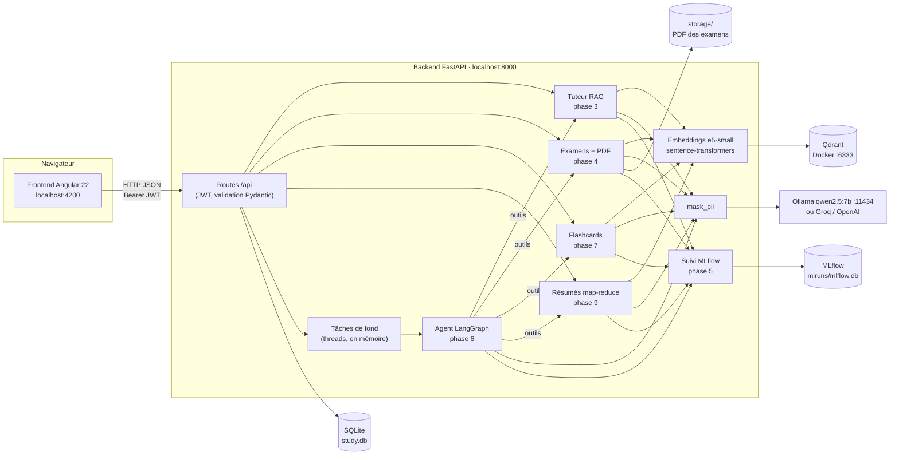
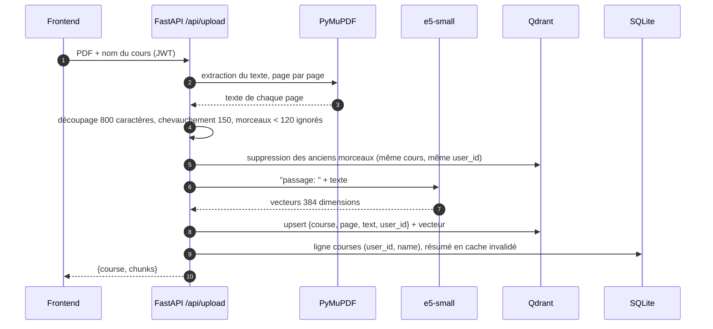
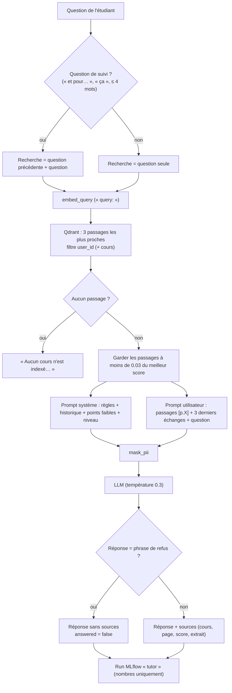
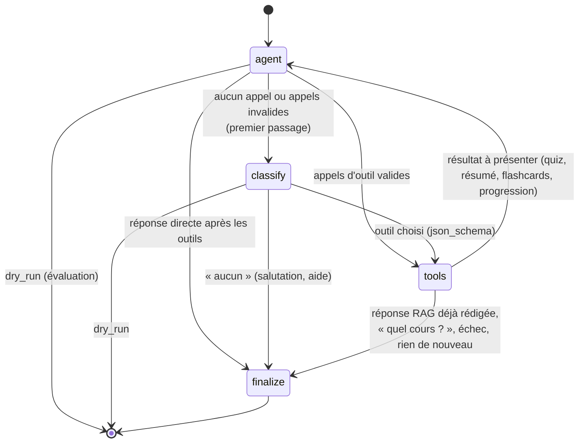
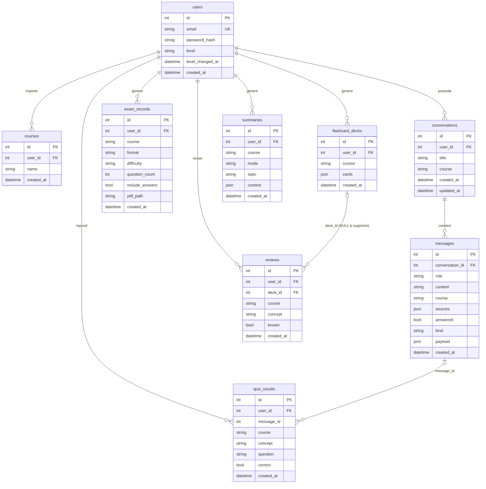

# Architecture

## 1. Vue d'ensemble



| Composant | Technologie | Rôle |
|---|---|---|
| Frontend | Angular 22 (composants autonomes, signaux), `marked` | pages Assistant, Flashcards, Résumés, Mes examens, Profil, connexion |
| API | FastAPI, Pydantic, SQLModel | routes REST, authentification, validation, gestion des erreurs |
| Base relationnelle | SQLite (`DATABASE_URL`) | comptes, cours, conversations, historiques, résumés, résultats de quiz |
| Base vectorielle | Qdrant (Docker) | morceaux des cours et leurs embeddings, filtrés par `user_id` |
| LLM | Ollama (qwen2.5:7b), API compatible OpenAI | génération, vérification, tool calling |
| Embeddings | intfloat/multilingual-e5-small | recherche sémantique, détection des doublons |
| Agent | LangGraph + `langchain-openai` | choix et enchaînement des outils |
| Suivi | MLflow (stockage SQLite) | un run par génération, traces de l'agent sans donnée personnelle |
| PDF | ReportLab | mise en page des examens |

Organisation du backend (`backend/app/`) :

```
core/                 config, base SQLite, sécurité (JWT, bcrypt), mask_pii
phase1_llm/           client LLM (chat, gestion des erreurs → LLMError)
phase2_embeddings/    embeddings, découpage des PDF, Qdrant
phase3_rag/           tuteur RAG, upload et liste des cours
phase4_exam/          générateur d'examens, schémas, PDF
phase4_finetuning/    jeu de données, notebook Colab LoRA, évaluation (hors application)
phase5_evaluation/    MLflow, benchmark, évaluation de l'agent, /api/stats
phase6_agent/         agent LangGraph, outils, tâches de fond, tracing
phase7_flashcards/    générateur de flashcards
phase8_personal/      comptes, cours privés, conversations, historiques, profil
phase9_summaries/     résumés map-reduce et explication d'un thème
```

## 2. Flux RAG

### 2.1 Import d'un cours



### 2.2 Question au tuteur



Les examens, flashcards et résumés lisent **tout le cours** (`get_course_chunks`, trié par page) au lieu des
3 passages du tuteur ; seuls l'explication d'un thème et les cartes utilisent une recherche sémantique.

## 3. Graphe de l'agent (LangGraph)



| Nœud | Rôle |
|---|---|
| `agent` | Le LLM reçoit le prompt système, les 6 derniers messages (masqués) et les 5 outils ; il appelle un outil ou répond. Au premier passage, une demande de résumé du cours entier routée vers `ask_course` est corrigée en `summarize`. |
| `classify` | Repli : classification d'intention en sortie structurée, puis appel de l'outil choisi. |
| `tools` | Exécute au plus 3 appels par message (arguments validés, doublons ignorés). Chaque outil appelle une fonction existante avec le `user_id` du jeton. |
| `finalize` | Texte final : réponse directe, ou réponse courte (3 phrases) qui présente le résultat ; la réponse du tuteur RAG n'est jamais reformulée. |

Outils : `ask_course` (tuteur RAG), `summarize` (résumé ou thème, réutilise le cache), `generate_quiz`
(générateur d'examens au format QCM, renvoyé en JSON), `generate_flashcards` (paquet enregistré),
`get_progress` (profil sans l'email).

Choix du cours : cours sélectionné dans la page → cours nommé par l'étudiant → seul cours du compte ;
sinon l'agent demande « Sur quel cours veux-tu travailler ? » avec des boutons de choix.

Exécution : `POST /api/companion/messages` lance l'agent dans une tâche de fond. Si la réponse est prête
en 20 s, elle est renvoyée directement (200) ; sinon la route répond **202** avec un `job_id`, et le
frontend consulte `GET /api/companion/jobs/{id}` en affichant l'outil en cours.

La page Assistant utilise la variante en streaming, `POST /api/companion/messages/stream` (Server-Sent Events) :
la même tâche de fond est lancée, et ses événements sont transmis au fil de l'eau. On reçoit d'abord `start`
(job_id), puis `tool` (outil en cours), puis `token` (fragments de la réponse du tuteur, affichés aussitôt), et
enfin `final` (messages enregistrés et réponse validée, avec ses sources) ou `error`. Si le flux est coupé après
`start`, la tâche continue côté serveur et le frontend la consulte avec `GET /api/companion/jobs/{id}`. nginx ne
met pas le flux en tampon (en-tête `X-Accel-Buffering: no`).

Appels au LLM : un sémaphore partagé limite les appels simultanés à `LLM_CONCURRENCY` (1 pour Ollama, 3 pour
Groq). Les appels indépendants (générations d'un tour, vérifications par type, cartes, blocs de concepts,
sections du résumé) passent par `parallel_map`. Avec 1, c'est une simple boucle séquentielle.

## 4. Modèle de données (SQLite)



| Table | Contenu | Remarques |
|---|---|---|
| `users` | compte étudiant | email unique (minuscules), mot de passe haché bcrypt, niveau `debutant` / `intermediaire` / `avance` |
| `courses` | cours importés | unique (`user_id`, `name`) ; les morceaux sont dans Qdrant avec le même `user_id` |
| `conversations` | fils de discussion de l'Assistant | `course` NULL = tous les cours ; titre automatique à partir de la première question |
| `messages` | messages des conversations | `kind` : `text`, `answer`, `quiz`, `summary`, `flashcards`, `progress` ; `payload` JSON pour l'affichage riche (questions du quiz et résultat, résumé, paquet…) |
| `exam_records` | historique des examens | le PDF est dans `STORAGE_DIR` (`pdf_path` relatif) |
| `flashcard_decks` | paquets de flashcards | cartes en JSON (`concept`, `front`, `back`, `page`) |
| `reviews` | « Je savais » / « À revoir » | gardées si le paquet est supprimé (statistiques du profil) |
| `summaries` | résumés et explications de thèmes | un seul résumé « cours entier » par cours (cache) |
| `quiz_results` | une ligne par question de quiz | alimente les points faibles avec `reviews` |

Les tables sont créées au démarrage (`init_db`). `migrate_messages` ajoute les colonnes `kind` et
`payload` à une base plus ancienne.

## 5. Routes de l'API

Toutes les routes sont préfixées par `/api`, sauf `/health`. « Protégée » : en-tête
`Authorization: Bearer <jeton>` obligatoire (sinon 401) ; chaque route ne lit que les données de
l'étudiant du jeton (404 pour la ressource d'un autre étudiant). Documentation interactive :
`http://localhost:8000/docs`.

### Comptes et profil

| Méthode | Chemin | Rôle | Protégée |
|---|---|---|---|
| POST | `/api/auth/register` | créer un compte (email, mot de passe 8 à 72 caractères, niveau) et recevoir un jeton | non |
| POST | `/api/auth/login` | se connecter et recevoir un jeton | non |
| GET | `/api/me` | compte connecté | oui |
| PATCH | `/api/me` | changer de niveau | oui |
| GET | `/api/profile` | statistiques, quiz, points faibles, suggestion de niveau | oui |

### Cours et tuteur

| Méthode | Chemin | Rôle | Protégée |
|---|---|---|---|
| POST | `/api/upload` | importer un PDF (multipart : `file`, `course` optionnel) et l'indexer | oui |
| GET | `/api/courses` | liste des cours de l'étudiant | oui |
| DELETE | `/api/courses/{course}` | supprimer un cours et ses morceaux | oui |
| POST | `/api/ask` | question au tuteur RAG, sans conversation | oui |
| POST | `/api/ask/stream` | même question en Server-Sent Events : fragments `token`, puis `final` (réponse validée, sources, `time_to_first_token`) | oui |

### Conversations

| Méthode | Chemin | Rôle | Protégée |
|---|---|---|---|
| GET | `/api/conversations` | conversations, la plus récente en premier | oui |
| POST | `/api/conversations` | créer une conversation | oui |
| PATCH | `/api/conversations/{id}` | renommer | oui |
| DELETE | `/api/conversations/{id}` | supprimer avec ses messages | oui |
| GET | `/api/conversations/{id}/messages` | messages de la conversation | oui |
| POST | `/api/conversations/{id}/messages` | question au tuteur RAG avec mémoire (3 échanges) | oui |

### Assistant (agent)

| Méthode | Chemin | Rôle | Protégée |
|---|---|---|---|
| POST | `/api/companion/messages` | message à l'agent : 200 si la réponse est prête en 20 s, sinon 202 + `job_id` | oui |
| POST | `/api/companion/messages/stream` | même message en Server-Sent Events (utilisé par la page Assistant) : `start` (job_id), `tool`, `token`, puis `final` ou `error` | oui |
| GET | `/api/companion/jobs/{job_id}` | état d'une tâche de fond (outil en cours, résultat, erreur) | oui |
| POST | `/api/quiz-results` | corriger un quiz de l'agent et enregistrer les réponses | oui |

### Examens

| Méthode | Chemin | Rôle | Protégée |
|---|---|---|---|
| POST | `/api/courses/{course}/exam` | générer un examen noté sur 20 et renvoyer le PDF | oui |
| GET | `/api/exams` | historique des examens | oui |
| GET | `/api/exams/{id}/pdf` | retélécharger le PDF | oui |
| DELETE | `/api/exams/{id}` | supprimer l'examen et son fichier | oui |

### Flashcards

| Méthode | Chemin | Rôle | Protégée |
|---|---|---|---|
| POST | `/api/courses/{course}/flashcards` | générer un paquet (10, 20 ou 30 cartes) | oui |
| GET | `/api/flashcards/decks` | paquets de l'étudiant (filtre `course` optionnel) | oui |
| GET | `/api/flashcards/decks/{id}` | contenu d'un paquet | oui |
| DELETE | `/api/flashcards/decks/{id}` | supprimer un paquet (les révisions restent) | oui |
| POST | `/api/reviews` | enregistrer « Je savais » / « À revoir » sur une carte | oui |

### Résumés

| Méthode | Chemin | Rôle | Protégée |
|---|---|---|---|
| POST | `/api/courses/{course}/summary` | résumé du cours entier (cache, sauf `regenerate`) ou explication d'un thème | oui |
| GET | `/api/summaries` | résumés de l'étudiant (filtre `course` optionnel) | oui |
| GET | `/api/summaries/{id}` | contenu d'un résumé | oui |
| DELETE | `/api/summaries/{id}` | supprimer un résumé | oui |

### Évaluation et système

| Méthode | Chemin | Rôle | Protégée |
|---|---|---|---|
| GET | `/api/stats` | moyennes des runs MLflow (globales, sans identifiant d'étudiant) | oui |
| GET | `/health` | état du serveur | non |

Codes d'erreur communs : **400** fichier ou entrée invalide, **401** jeton absent ou expiré, **404**
ressource introuvable ou d'un autre étudiant, **409** conflit (email déjà utilisé, quiz déjà corrigé),
**422** validation ou génération sans sortie valide, **503** LLM indisponible (timeout, quota, clé absente
ou invalide, serveur injoignable).
